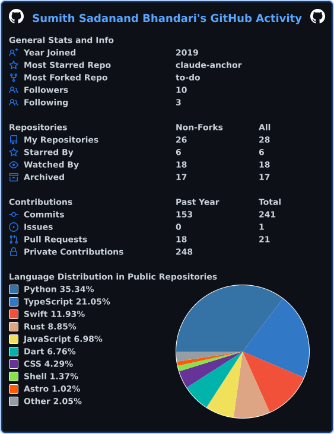

# Hi, I'm Sumith Sadanand Bhandari 👋

**AI Software Engineer | Production AI Agents | Python | RAG | TypeScript**

*London, UK*

---

## 🚀 About Me

I build production AI agents and the backend systems around them. I have **4+ years** of backend and AI agent work: multi-agent workflows, RAG and document extraction pipelines, LLM integrations (Anthropic, OpenAI) and the APIs, databases and deployments that keep them running.

**MSc Advanced Computer Science (Distinction)**, University of Leicester. Open to **AI Software Engineer** and **Forward Deployed Engineer** roles in London, contract or permanent.

---

## 💼 Experience

| Where | What I did |
|---|---|
| **Goodspeed Studio** AI Engineer, Jul 2026 to present | Build and run production AI agents: a Slack agent used daily by 16+ people, with multi-tenant memory, human-review steps and business tool integrations, plus a website chat agent taken through a GDPR, PECR and EU AI Act review before launch. |
| **Visiminds Technologies** Software Engineer, 2025 | VAPT automation platform in Python, Flask and MongoDB running 14 security tools. A job queue with 20 concurrent workers cut scan and report time from about 4 hours to under 15 minutes. |
| **TechMachinery** Software Engineer, 2021 to 2024 | Led backend work on Pluto, a TechMachinery platform for designing heat exchanger systems in plain language. Multi-agent system on Strands (AWS) with pgvector retrieval; 94% extraction accuracy on a 50-document test set. |

---

## 🔑 Featured Projects

<table>
<tr>
<td width="50%" valign="top">

### ⚓ [Claude Anchor](https://github.com/SumithSB/claude-anchor)
Routes Claude Code to the right Claude account for each project folder. Tracks the 5-hour and weekly limits per account and moves to one with headroom before a session stalls.

</td>
<td width="50%" valign="top">

### 🧠 [Brainvault](https://github.com/SumithSB/brainvault)
Persistent local memory for AI coding agents such as Claude Code and Cursor. One SQLite vault, 12 MCP tools, session hooks, FTS5 and optional semantic search.

</td>
</tr>
<tr>
<td colspan="2" valign="top">

### 👗 Fashion AI (MSc dissertation, Best Technical Project 2026)
Mobile styling app with skin tone analysis, a recommender over a 59,447-product catalogue and a RAG styling chat (MRR@6 of 0.91 over 53 evaluation queries).

</td>
</tr>
</table>

---

## 🛠️ Tech Stack

**Languages** 

**AI** 

-FF9900?style=flat-square&logo=amazonaws&logoColor=white)

**Backend** 

**Data** 

**Infra** 

---

## 📊 GitHub Stats

---

**Let's connect:** [Portfolio](https://sumithsb.github.io/portfolio) · [LinkedIn](https://linkedin.com/in/sumith-sadanand-bhandari) · [Email](mailto:sumithsbhandari@gmail.com)

